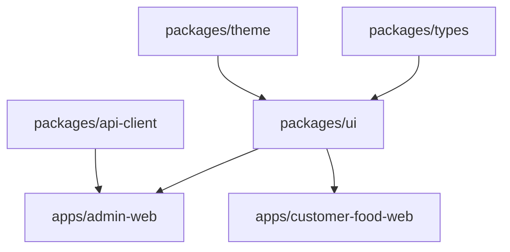

# Lesson 01: Monorepo Architecture, pnpm Workspaces & Turborepo
> **Target Audience**: Main Lead Engineer & Software Architect  
> **Repository Context**: `SSR One AI` (`e:/2026/ssr_one_ai`)  
> **Prerequisites**: Basic terminal and JavaScript/Node.js understanding.

---

## 1. What It Is (Simple Explanation & Real-Life Analogy)

A **monorepo** (short for *monolithic repository*) is a software development approach where all the separate applications, microservices, and shared libraries of an entire company or platform live inside a **single Git repository**, rather than being scattered across dozens of individual repositories.

### Real-Life Analogy
Imagine a luxury multi-cuisine restaurant with 5 kitchens: one for North Indian, one for Bakery, one for Pizzas, one for Fast Food, and one for Drinks.
* **The Multi-Repo way**: Each kitchen has its own private supplier, its own spice storage room, its own billing book, and its own rules. If the pizza chef changes the house tomato sauce recipe, the pasta chef in the next room has no idea and keeps cooking with the old sauce.
* **The Monorepo way**: The entire restaurant shares one master central kitchen pantry, a single unified inventory book, and standard chef knives. If the head chef improves the house sauce in the shared pantry, all 5 kitchens instantly use the new recipe in real-time, with zero delays and zero version conflicts.

In SSR One AI, our 8 frontend web portals (`apps/admin-web`, `apps/customer-food-web`, `apps/kds-web`, etc.) and our 13 shared packages (`packages/ui`, `packages/api-client`, `packages/auth`, etc.) live in one single Git tree managed by **pnpm workspaces** and built at lightning speed by **Turborepo**.

---

## 2. Why This Project Uses It (The Problem It Solves & Alternatives)

### The Problem It Solves in SSR One AI
SSR One AI has:
1. **8 different Web Apps**:
   - `admin-web`: Full ERP POS, Billing, Table layout, Hotel rooms, Accounting.
   - `customer-food-web`: QR table scanning, digital food ordering menu for guests.
   - `customer-stay-web`: Hotel room booking & PG guest portal.
   - `kds-web`: Kitchen Display System screen for chefs.
   - `staff-web`: Waiter tablet app for taking table orders.
   - `token-order-web`: Fast-food token display on TV screens.
   - `platform-admin`: Superadmin billing and tenant licensing.
   - `marketing-web`: Public product sales website.
2. **13 Shared Internal Libraries**:
   - Every single app needs to know what an `Order`, a `Tenant`, a `MenuItem`, or a `User` is.
   - Every app needs the same `@ssrone/ui` buttons, badges, and modal dialogs.
   - Every app needs `@ssrone/api-client` to attach the `X-Tenant-Slug` HTTP header.

If we had 21 separate Git repositories, changing one button or adding one field to `Order` would require:
1. Making a pull request in `@ssrone/types`.
2. Publishing it to npm.
3. Running `npm update` across 8 different frontend repositories.
4. Dealing with mismatched package versions when one app forgets to update.

With our monorepo:
* We change the `Order` type in `packages/types/src/index.ts` **once**.
* All 8 apps immediately see the updated type with 0 seconds delay.
* TypeScript catches any breaking changes across the entire platform in a single command (`pnpm run type-check`).

### Alternatives Considered & Why Rejected
* **npm / yarn v1 workspaces**: Very slow, creates bloated `node_modules` folders taking tens of gigabytes of disk space because they duplicate packages in every folder.
* **Lerna**: Outdated, overly complex setup compared to modern Turborepo.
* **Nx**: Powerful but heavily opinionated with high configuration overhead.
* **Turborepo + pnpm (Chosen)**: The industry gold standard. Turborepo caches build outputs, runs tasks in parallel on all CPU cores, and pnpm uses hard links to save 80% disk space.

---

## 3. Core Concepts (From Zero to Architect)

### Concept A: Package Boundaries (`apps/` vs `packages/`)
* **`apps/*` (Applications)**: These are runnable entry points that get deployed to the web (e.g. `admin-web` deployed on Netlify or Render). They generate HTML/JS bundles.
* **`packages/*` (Shared Libraries)**: These are internal utility libraries. They cannot be deployed alone; they exist solely to be imported by apps or other packages.

### Concept B: The Workspace Protocol (`workspace:*`)
When `apps/admin-web/package.json` needs `@ssrone/api-client`, it does **not** download it from the public internet. Instead, it writes:
```json
"@ssrone/api-client": "workspace:*"
```
The `workspace:*` prefix tells pnpm: *"Do not search the internet npm registry. Link directly to the local folder `../../packages/api-client` on my hard drive."*

### Concept C: Content-Addressable Storage (How pnpm Saves Gigabytes)
When you use `npm install`, if 8 apps use `react@19.0.0`, npm downloads 8 full copies of React onto your hard drive.
**pnpm** downloads `react@19.0.0` **exactly once** into a global content-addressable store (`~/.pnpm-store`). Inside each app's `node_modules`, it creates an operating system **hard link** pointing to that one copy. This makes `pnpm install` up to 3x faster and saves enormous disk space.

### Concept D: Topological Task Graph (Turborepo)
When you run `pnpm run build`:
How does the computer know which order to build things in?
If `admin-web` depends on `@ssrone/ui`, and `@ssrone/ui` depends on `@ssrone/theme`, Turborepo inspects all `package.json` files and builds a directed acyclic graph (DAG):



Turborepo automatically builds `packages/theme` first, then `packages/ui`, and only then builds `admin-web` and `customer-food-web` **in parallel**.

---

## 4. Syntax & Configuration Breakdown

### 1. `pnpm-workspace.yaml` (Workspace Declaration)
This file at the root of the project tells pnpm which directories contain packages.

```yaml
packages:
  - "apps/*"       # Every subfolder inside apps/ is an independent package
  - "packages/*"   # Every subfolder inside packages/ is an independent package
  - "services/*"   # Backend services (e.g. backend)
```

### 2. `turbo.json` (Pipeline Configuration)
Located at the root of the repository:

```json
{
  "$schema": "https://turbo.build/schema.json",
  "ui": "tui",
  "tasks": {
    "build": {
      "dependsOn": ["^build"],
      "outputs": ["dist/**", "build/**"]
    },
    "lint": {},
    "test": {
      "outputs": ["coverage/**"]
    },
    "type-check": {},
    "dev": {
      "cache": false,
      "persistent": true
    }
  }
}
```

#### Keyword Breakdown:
* `"dependsOn": ["^build"]`: The `^` (caret) symbol is critical. It means **topological dependency**. Before building *this* package, build all the internal packages that this package *depends on* first!
* `"outputs": ["dist/**"]`: Tells Turborepo which files to cache. If nothing in `packages/ui` changed since the last build, Turborepo skips compiling it and restores `dist/` instantly from cache in 5 milliseconds (`FULL TURBO`).
* `"cache": false`: For long-running dev servers (`pnpm run dev`), caching is disabled because the server must stay alive and watch for file changes.
* `"persistent": true`: Tells Turborepo this is an ongoing process (like a live Vite server), so do not kill it after one run.

### 3. `.npmrc` (Monorepo Enforcements)
Located at root:
```ini
auto-install-peers=true
link-workspace-packages=true
```
* `link-workspace-packages=true`: Forces pnpm to link local monorepo packages automatically even if someone forgot to write `workspace:*`.

---

## 5. How It Is Used in OUR Project (Real Code & Request Flow)

Let's examine how our root [package.json](file:///e:/2026/ssr_one_ai/package.json) orchestrates everything:

```json
// Lines 11-28 in e:/2026/ssr_one_ai/package.json
"scripts": {
  "dev": "turbo run dev",
  "dev:admin": "pnpm --filter @ssrone/admin-web dev",
  "dev:food": "pnpm --filter @ssrone/customer-food-web dev",
  "dev:stay": "pnpm --filter @ssrone/customer-stay-web dev",
  "dev:kds": "pnpm --filter @ssrone/kds-web dev",
  "dev:staff": "pnpm --filter @ssrone/staff-web dev",
  "dev:superadmin": "pnpm --filter @ssrone/platform-admin dev",
  "dev:marketing": "pnpm --filter @ssrone/marketing-web dev",
  "dev:token": "pnpm --filter @ssrone/token-order-web dev",
  "build": "turbo run build",
  "test": "turbo run test",
  "type-check": "turbo run type-check",
  "lint": "turbo run lint"
}
```

### The `--filter` Flag (Targeting Exact Projects)
When you are working as the lead developer on the POS table billing screen in `admin-web`, you do **not** want to boot up all 8 web apps simultaneously.
You run:
```bash
pnpm --filter @ssrone/admin-web dev
```
`--filter` tells pnpm: *"Only run the `dev` script inside the package whose name in package.json is `@ssrone/admin-web`."*

### How an Import Flows Across the Monorepo:
1. In [packages/api-client/src/index.ts](file:///e:/2026/ssr_one_ai/packages/api-client/src/index.ts#L422), we export the function:
   ```typescript
   export const fetchMenuItems = async (branchId?: number | string): Promise<any[]> => { ... }
   ```
2. In [apps/admin-web/package.json](file:///e:/2026/ssr_one_ai/apps/admin-web/package.json#L22), it declares:
   ```json
   "dependencies": {
     "@ssrone/api-client": "workspace:*"
   }
   ```
3. Inside [apps/admin-web/src/modules/pos/pages/terminal/POSTerminalPage.tsx](file:///e:/2026/ssr_one_ai/apps/admin-web/src/modules/pos/pages/terminal/POSTerminalPage.tsx), the developer writes:
   ```typescript
   import { fetchMenuItems } from "@ssrone/api-client";
   ```
4. **Resolution Flow**:
   Vite and TypeScript look at `tsconfig.base.json` paths and pnpm's `node_modules/@ssrone/api-client` symlink. They resolve it directly to `e:/2026/ssr_one_ai/packages/api-client/src/index.ts`.
   * Result: **Instant hot-module reloading**. The moment you edit a line in `packages/api-client`, your browser window running `admin-web` updates immediately!

---

## 6. Common Mistakes & Gotchas (What Breaks & How to Debug)

### Mistake 1: The "Phantom Dependency" Bug
* **What happens**: You install a library like `lodash` inside `apps/admin-web`, but then in `apps/customer-food-web` you write `import lodash from 'lodash'`. It works on your laptop because `node_modules` hoisted it, but when deploying to Netlify or Render, the build crashes with `Cannot find module 'lodash'`.
* **How to fix**: Always install dependencies in the specific package that uses them:
  ```bash
  pnpm --filter @ssrone/customer-food-web add lodash
  ```

### Mistake 2: Circular Package Dependencies
* **What happens**: Package A imports Package B, and Package B imports Package A. Turborepo's DAG fails with a circular dependency error: `Cycle detected: @ssrone/ui -> @ssrone/theme -> @ssrone/ui`.
* **Architectural Rule**: Clean hierarchy flow.
  `apps/*` ➡️ `packages/ui` ➡️ `packages/theme` ➡️ `packages/types`.
  Lower-level packages must NEVER import from higher-level packages!

### Mistake 3: Forgetting to Build Dependent Packages
* **What happens**: You build `admin-web` on Render and it says `@ssrone/ui/dist not found`.
* **Why**: The build task in `turbo.json` must have `"dependsOn": ["^build"]`. This guarantees that `@ssrone/ui` compiles its code before `admin-web` starts compiling.

### Debugging Monorepo Issues:
If packages behave weirdly or types seem out of date:
```bash
# 1. Clean all build caches
pnpm clean || rm -rf node_modules apps/*/dist packages/*/dist .turbo

# 2. Re-link all workspace packages
pnpm install

# 3. Verify type-checking across all packages
pnpm run type-check
```

---

## 7. Best Practices & Performance Tips for POS Systems

1. **Keep Shared Packages Headless & Lean**:
   Avoid putting heavy dependencies in `@ssrone/ui`. If an icon is only needed in one screen, do not import 500 icons into the shared bundle.
2. **Strict Workspace Versioning**:
   Always use `"workspace:*"` for internal packages. Never hardcode version numbers like `"1.0.0"` for internal packages, or pnpm will try to fetch them from npm instead of your local disk.
3. **Turborepo Remote Caching**:
   In production CI/CD (GitHub Actions), enable Turborepo caching so that builds take 20 seconds instead of 4 minutes.

---

## 8. Hands-On Practice Exercises

### Exercise 1 (Easy):
Add a new convenience npm script in the root [package.json](file:///e:/2026/ssr_one_ai/package.json) called `"lint:admin"` that only lints `@ssrone/admin-web`.

### Exercise 2 (Medium):
You are creating a new shared package called `@ssrone/validators` inside `packages/validators`. What files must be created for pnpm and Turborepo to recognize it as a valid workspace package?

### Exercise 3 (Hard):
Inspect [apps/admin-web/package.json](file:///e:/2026/ssr_one_ai/apps/admin-web/package.json). Notice how it imports `@ssrone/api-client`, `@ssrone/auth`, `@ssrone/ui`, `@ssrone/navigation`, and `@ssrone/theme`. Trace what happens if you add a new exported function in `packages/auth/src/index.ts` and write a code snippet in `admin-web` that imports and calls it.

<details>
<summary><strong>Click to View Solutions</strong></summary>

#### Solution 1:
In root `package.json` under `"scripts"`:
```json
"lint:admin": "pnpm --filter @ssrone/admin-web lint"
```

#### Solution 2:
1. Create folder: `packages/validators`
2. Create `packages/validators/package.json`:
   ```json
   {
     "name": "@ssrone/validators",
     "version": "1.0.0",
     "private": true,
     "main": "./src/index.ts",
     "types": "./src/index.ts"
   }
   ```
3. Create `packages/validators/src/index.ts` with your exports.
4. Run `pnpm install` at the root so pnpm registers the symlinks.

#### Solution 3:
In `packages/auth/src/index.ts`:
```typescript
export const getActiveTenantRole = (): string => "ADMIN";
```
Then in any file in `apps/admin-web/src/...`:
```typescript
import { getActiveTenantRole } from "@ssrone/auth";
console.log(getActiveTenantRole()); // Prints "ADMIN"
```
Because of `workspace:*`, Vite picks up the new export immediately with zero compilation step required!
</details>

---

## 9. Self-Test & Feynman Active Recall

### 5 Recall Questions:
1. What is the difference between an entry in `apps/` and an entry in `packages/`?
2. What does the `workspace:*` string in a `package.json` dependency signify?
3. How does pnpm's content-addressable storage prevent disk bloat compared to standard npm?
4. What does the caret symbol `^` mean inside `"dependsOn": ["^build"]` in `turbo.json`?
5. Which flag in pnpm allows you to run a command for only one single app in the monorepo?

### 2 Feynman Prompts (Explain in Your Own Words):
* *Prompt 1*: Imagine a junior frontend developer joins your team and asks: *"Why can't we just copy-paste our Button component into each of the 8 apps instead of having this complex monorepo?"* How would you explain the architectural disaster that creates 6 months later?
* *Prompt 2*: Explain to a non-technical hotel/restaurant owner how our monorepo architecture ensures that an update to our tax calculation formula reaches their billing counter and their customer QR ordering menu simultaneously without errors.

---

## 10. Architect's Cheat Sheet (One-Screen Summary)

```bash
# ─── PNPM MONOREPO COMMANDS ──────────────────────────────────
pnpm install                     # Install & link all workspace packages
pnpm --filter <pkg-name> <cmd>   # Run command on a single package
pnpm --filter @ssrone/admin-web dev      # Start Admin POS dev server
pnpm --filter @ssrone/customer-food-web dev # Start Food QR dev server
pnpm --filter @ssrone/ui add <pkg>       # Add npm dependency to @ssrone/ui

# ─── TURBOREPO BUILD COMMANDS ────────────────────────────────
pnpm run build                   # Build entire monorepo in topological order
pnpm run type-check              # Typecheck all 8 apps & 13 packages in parallel
pnpm run lint                    # Lint all packages with Turborepo caching
pnpm run test                    # Run all Vitest & Pytest suites

# ─── MONOREPO DIRECTORY ANATOMY ──────────────────────────────
/apps/               # Deployable web apps (admin-web, food-web, kds-web, etc.)
/packages/           # Shared libraries (ui, api-client, auth, types, theme)
/services/           # Backend microservices (services/backend - FastAPI)
/pnpm-workspace.yaml # Defines package paths for pnpm
/turbo.json          # Dependency graph & task caching rules
/.npmrc              # Workspace linking & peer dependency policies
```

---
*Next Lesson: **[Lesson 02: TypeScript Foundations & Shared Types](file:///e:/2026/ssr_one_ai/docs/learning/02-typescript-foundations.md)***
