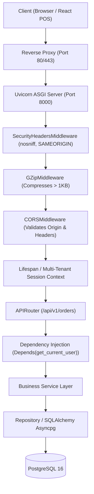

# Lesson 04: FastAPI ASGI Lifecycle, Routers, Middlewares & Uvicorn
> **Target Audience**: Main Lead Engineer & Software Architect  
> **Repository Context**: `SSR One AI` (`e:/2026/ssr_one_ai`)  
> **Prerequisites**: [Lesson 01: Monorepo Architecture](file:///e:/2026/ssr_one_ai/docs/learning/01-monorepo-pnpm-turbo.md), [Lesson 03: Docker & Compose](file:///e:/2026/ssr_one_ai/docs/learning/03-docker-and-compose.md)

---

## 1. What It Is (Simple Explanation & Real-Life Analogy)

**FastAPI** is a modern, high-performance web framework for Python designed around asynchronous programming (`async`/`await`). It runs on top of an **ASGI** (*Asynchronous Server Gateway Interface*) web server called **Uvicorn**, which handles thousands of simultaneous incoming HTTP connections using a non-blocking event loop.

### Real-Life Analogy
Imagine a busy restaurant counter with 1 cashier:
* **The Traditional WSGI Way (Django / Flask)**: A customer orders a pizza that takes 15 minutes to bake. The cashier takes the order, walks back into the kitchen, stands in front of the oven for 15 minutes waiting for the pizza, and refuses to talk to anyone else in line. The entire queue of 50 customers is completely frozen because 1 customer's food is cooking.
* **The Modern ASGI Way (FastAPI + Uvicorn)**: The cashier takes the order, gives the customer a buzzer token, immediately hands the ticket to the kitchen, and turns to the next customer in line 1 millisecond later. When the oven dings, the cashier buzzes the customer to pick up the pizza. One cashier serves 1,000 customers an hour without breaking a sweat.

In SSR One AI, when a waiter punches an order or a guest scans a QR code, FastAPI does not freeze waiting for PostgreSQL to write to disk. It registers an async callback, immediately serves other requests, and returns the finished bill the microsecond the database finishes.

---

## 2. Why This Project Uses It (The Problem It Solves & Alternatives)

### The Problem It Solves in SSR One AI
Hospitality operations feature extreme burst traffic:
1. **Lunch & Dinner Rushes**: Between 1:00 PM and 2:30 PM, 50 tables punch KOT orders, 10 waiters send items, the Kitchen screen polls for updates, and customers scan QR codes simultaneously.
2. **Real-Time WebSockets**: Kitchen Display Screens (KDS) must maintain persistent, open network sockets for hours.
3. **Automatic Interactive API Documentation (`/docs`)**: FastAPI automatically inspects our Pydantic schemas and generates an interactive Swagger UI at `http://localhost:8000/docs`, allowing us to test any API endpoint with zero extra code.

### Alternatives Considered & Why Rejected
* **Django / Django REST Framework**: Synchronous (WSGI) by default, heavy, slow cold starts, and complex ORM migrations compared to modern async pipelines.
* **Flask**: Outdated synchronous framework; requires bolting on 15 third-party plugins for validation, typing, and async.
* **Node.js / Express**: Fast, but lacks Python's world-class data science, OCR (`pytesseract`), machine learning (`scikit-learn`), and PDF generation (`weasyprint`) ecosystem.
* **FastAPI (Chosen)**: Matches Node.js and Go in speed benchmarks, offers native async/await, auto-generates OpenAPI docs, and leverages Python's complete AI/OCR ecosystem.

---

## 3. Core Concepts (From Zero to Architect)

### Concept A: WSGI vs ASGI
* **WSGI (Web Server Gateway Interface)**: The legacy Python standard (Django, Flask). Synchronous: One thread handles one HTTP request from start to finish. If 20 threads are busy waiting on database queries, request #21 is blocked.
* **ASGI (Asynchronous Server Gateway Interface)**: The modern standard (FastAPI, Starlette). Asynchronous: Single-threaded event loop (`uvloop`) managing thousands of concurrent tasks cooperatively via non-blocking I/O.

### Concept B: The Python `async` and `await` Keywords
* `async def`: Declares a coroutine function (a function that can be paused and resumed).
* `await`: The pause button. It tells the Python event loop: *"Pause this function right here while waiting for the database/network to respond. Go do other work in the meantime!"*
  ```python
  # Non-blocking async database query
  result = await session.execute(select(Order).where(Order.id == order_id))
  ```

### Concept C: The Request Lifecycle & Middlewares
Every HTTP request follows a strict journey through our backend:



### Concept D: Dependency Injection (`Depends()`)
FastAPI has the most powerful dependency injection system in modern web development.
Instead of manually checking tokens or opening database connections in every endpoint, you declare dependencies in the function arguments:
```python
@router.post("/orders")
async def create_order(
    payload: CreateOrderRequest,
    db: AsyncSession = Depends(get_db_session),
    current_user: User = Depends(get_current_user)
):
    # FastAPI automatically ran get_db_session() and get_current_user()
    # before this function was even called!
```

---

## 4. Syntax & Feature Breakdown

### 1. The Lifespan Context Manager (`@asynccontextmanager`)
In modern FastAPI, startup and shutdown events are managed via a Python context manager called **lifespan**.
Everything *before* the `yield` runs once when the server boots up. Everything *after* the `yield` runs when the server gracefully shuts down.

```python
from contextlib import asynccontextmanager
from fastapi import FastAPI

@asynccontextmanager
async def lifespan(app: FastAPI):
    # --- STARTUP LOGIC ---
    print("🚀 Initializing Database connections...")
    yield # Server is now running and accepting traffic
    # --- SHUTDOWN LOGIC ---
    print("🛑 Closing connection pools and releasing locks...")

app = FastAPI(lifespan=lifespan)
```

### 2. Custom Middlewares (`BaseHTTPMiddleware`)
A middleware intercepts **every single request** before it reaches your route handler, and intercepts **every response** before it leaves the server:

```python
from starlette.middleware.base import BaseHTTPMiddleware
from starlette.requests import Request
from starlette.responses import Response

class ExecutionTimeMiddleware(BaseHTTPMiddleware):
    async def dispatch(self, request: Request, call_next) -> Response:
        start_time = time.time()
        response = await call_next(request) # Forwards request to router
        process_time = time.time() - start_time
        response.headers["X-Process-Time"] = f"{process_time:.4f}s"
        return response
```

### 3. Modular Routers (`APIRouter`)
Instead of putting all endpoints in one file, endpoints are grouped into domain-specific routers and mounted onto the main app:

```python
from fastapi import APIRouter

router = APIRouter(prefix="/orders", tags=["Orders"])

@router.get("/")
async def list_orders():
    return [{"id": "ORD-1", "total": 450.0}]
```

---

## 5. How It Is Used in OUR Project (Real Code & Request Flow)

Let's examine our real production entry point: [services/backend/src/main.py](file:///e:/2026/ssr_one_ai/services/backend/src/main.py).

### 1. Lifespan Database Schema Verification:
```python
# Lines 53-84 in services/backend/src/main.py
@asynccontextmanager
async def lifespan(app: FastAPI):
    """ASGI application lifecycle manager."""
    try:
        from src.core.database.engine import engine
        from src.core.database.models import Base
        
        # Configure all SQLAlchemy ORM mappers deterministically on startup
        Base.registry.configure()

        # Execute full DDL schema verification to guarantee all tables exist
        async with engine.begin() as conn:
            await conn.run_sync(Base.metadata.create_all, checkfirst=True)

        logger.info("✅ Database DDL schema verified & configured (Pure SSOT context active)")
    except Exception as exc:
        print(f"Lifespan DB setup warning: {exc}")
    yield
```

#### Line-by-Line Breakdown:
* `Base.registry.configure()`: Crucial in SQLAlchemy 2.0. Resolves all foreign key relationships between disparate model files (e.g. `Order` pointing to `Restaurant` and `User`) **before** the first web request arrives.
* `engine.begin() as conn`: Opens an async transactional connection to Neon PostgreSQL.
* `conn.run_sync(Base.metadata.create_all, checkfirst=True)`: Verifies that all 50+ database tables exist. If any new table was added, it creates it safely without locking the database.

### 2. Enterprise Security Middlewares:
```python
# Lines 92-110 in services/backend/src/main.py
class SecurityHeadersMiddleware(BaseHTTPMiddleware):
    async def dispatch(self, request: Request, call_next) -> Response:
        response = await call_next(request)
        response.headers["X-Content-Type-Options"] = "nosniff"
        response.headers["X-Frame-Options"] = "SAMEORIGIN"
        response.headers["X-XSS-Protection"] = "1; mode=block"
        return response

app.add_middleware(SecurityHeadersMiddleware)
app.add_middleware(GZipMiddleware, minimum_size=1000)
```
* `X-Content-Type-Options: nosniff`: Prevents malicious browsers from MIME-sniffing a text file into an executable script.
* `X-Frame-Options: SAMEORIGIN`: Prevents attackers from embedding our POS billing screen inside an `<iframe>` on an external phishing website (Clickjacking protection).
* `GZipMiddleware(minimum_size=1000)`: Automatically compresses any JSON response larger than 1,000 bytes with Gzip, cutting network bandwidth for large menus by up to 70%!

### 3. Production CORS Boundary:
```python
# Lines 134-146 in services/backend/src/main.py
all_allowed_origins = list(set(default_origins + custom_origins))
cors_regex = os.getenv("CORS_ORIGIN_REGEX", r"https?://.*(\.ssrone\.ai|\.railway\.app|\.netlify\.app)(:[0-9]+)?")
if os.getenv("APP_ENV", "development").lower() == "development":
    cors_regex = r"https?://.*"

app.add_middleware(
    CORSMiddleware,
    allow_origins=all_allowed_origins,
    allow_origin_regex=cors_regex,
    allow_credentials=True,
    allow_methods=["*"],
    allow_headers=["*"],
)
```
Notice the security architecture: In production, CORS uses a strict regex allowing only our official domains (`*.ssrone.ai`, `*.railway.app`, `*.netlify.app`). In local development (`APP_ENV=development`), it flexibly accepts any localhost port.

### 4. Mounting All 21 Domain Routers:
```python
# Lines 174-196 in services/backend/src/main.py
v1_prefix = "/api/v1"
app.include_router(auth_router, prefix=v1_prefix)
app.include_router(restaurant_router, prefix=v1_prefix)
app.include_router(orders_router, prefix=v1_prefix)
app.include_router(billing_router, prefix=v1_prefix)
app.include_router(inventory_router, prefix=v1_prefix)
# ... all 21 microservice routers mounted cleanly under /api/v1
```

---

## 6. Common Mistakes & Gotchas (What Breaks & How to Debug)

### Mistake 1: Blocking the Event Loop (The Cardinal Sin of Async)
* **What happens**: A developer writes:
  ```python
  import time

  @router.get("/report")
  async def get_report():
      time.sleep(5) # ❌ FATAL MISTAKE!
      return {"status": "done"}
  ```
* **Why it destroys your server**: `time.sleep(5)` is **synchronous**. It freezes the entire Python operating thread for 5 seconds. Every other waiter, kitchen screen, and guest across all restaurant branches is completely frozen!
* **The Rule**: Always use `await asyncio.sleep(5)` or offload heavy CPU-bound tasks to Celery background workers.

### Mistake 2: Using Synchronous Database Libraries inside `async def`
* **What happens**: Writing `requests.get()` or synchronous `session.query()` inside an `async def` endpoint.
* **Fix**: Always use `httpx.AsyncClient` for external HTTP calls, and `await session.execute()` with `asyncpg` for database queries.

### Mistake 3: Leaking Database Secrets in Production Errors
* **What happens**: If an unhandled SQL error occurs, FastAPI might return the full raw PostgreSQL error string to the user, exposing table names and column layouts.
* **Our Protection**: Look at lines 149–167 in [services/backend/src/main.py](file:///e:/2026/ssr_one_ai/services/backend/src/main.py#L149-L167). Our `global_exception_handler` intercepts all crashes: in development it shows the traceback, but in production it returns a sanitized generic error:
  ```json
  {
    "detail": "An internal server error occurred. Please contact system administrator.",
    "error_type": "InternalServerError"
  }
  ```

---

## 7. Best Practices & Performance Tips for POS Systems

1. **Keep Path Operations Shallow**: Route handlers should contain zero business logic. They should only:
   1. Validate inputs (via Pydantic).
   2. Call a Service method (`OrderService.create_order()`).
   3. Return an HTTP status code (`201 Created`).
2. **Use Uvicorn Workers in Production**: On multi-core production cloud servers, launch Uvicorn with multiple worker processes matching CPU cores:
   ```bash
   uvicorn src.main:app --host 0.0.0.0 --port 8000 --workers 4
   ```
3. **Always Return Proper HTTP Status Codes**:
   - `200 OK`: Successful read or update.
   - `201 Created`: Successful creation of order, receipt, or menu item.
   - `204 No Content`: Successful deletion.
   - `400 Bad Request`: Validation failure.
   - `401 Unauthorized`: Missing or invalid JWT token.
   - `403 Forbidden`: Authenticated user lacks permission (e.g. Waiter trying to refund a bill).
   - `404 Not Found`: Entity does not exist.

---

## 8. Hands-On Practice Exercises

### Exercise 1 (Easy):
Inspect [services/backend/src/main.py](file:///e:/2026/ssr_one_ai/services/backend/src/main.py#L199-L211). Add a new endpoint `@app.get("/ping")` that returns `{"pong": True, "server_time": "<iso-timestamp>"}`.

### Exercise 2 (Medium):
Write a custom FastAPI dependency function called `verify_admin_role(current_user: User = Depends(get_current_user))` that raises an `HTTPException(status_code=403, detail="Admin privileges required")` if `current_user.is_superadmin` is `False`.

### Exercise 3 (Hard):
Trace what happens when an incoming HTTP POST request hits `/api/v1/orders`. List every middleware and lifecycle component it passes through in [services/backend/src/main.py](file:///e:/2026/ssr_one_ai/services/backend/src/main.py) before reaching the order handler function.

<details>
<summary><strong>Click to View Solutions</strong></summary>

#### Solution 1:
```python
from datetime import datetime, timezone

@app.get("/ping", tags=["Health"])
async def ping():
    return {
        "pong": True,
        "server_time": datetime.now(timezone.utc).isoformat()
    }
```

#### Solution 2:
```python
from fastapi import HTTPException, status, Depends

async def verify_admin_role(current_user: User = Depends(get_current_user)) -> User:
    if not current_user.is_superadmin:
        raise HTTPException(
            status_code=status.HTTP_403_FORBIDDEN,
            detail="Admin privileges required to access this resource"
        )
    return current_user
```

#### Solution 3:
1. **Network**: Handled by Uvicorn ASGI server loop.
2. **Middlewares in Order**:
   - `SecurityHeadersMiddleware`: Intercepts request, awaits downstream processing.
   - `GZipMiddleware`: Prepares compression buffer if response exceeds 1,000 bytes.
   - `CORSMiddleware`: Validates `Origin` header against `cors_regex`. If preflight `OPTIONS` request, responds immediately; otherwise passes through.
3. **Routing Match**: Matches `prefix="/api/v1"` and forwards to `orders_router`.
4. **Dependencies**: Executes `Depends()` parameters (authenticates JWT, checks tenant slug header, establishes async SQLAlchemy session).
5. **Validation**: Pydantic validates the JSON request body against `CreateOrderSchema`.
6. **Execution**: Handler function executes business logic and returns response.
7. **Reverse Middleware Pass**: Response passes back through GZip and SecurityHeaders before leaving Uvicorn.
</details>

---

## 9. Self-Test & Feynman Active Recall

### 5 Recall Questions:
1. What is the fundamental difference between WSGI and ASGI?
2. What happens to other users on a server if a developer writes `time.sleep(10)` inside an `async def` FastAPI route?
3. What is the purpose of `@asynccontextmanager def lifespan(app: FastAPI)`?
4. Why does our backend use `GZipMiddleware(minimum_size=1000)`?
5. How does FastAPI's `Depends()` pattern help keep code clean and secure?

### 2 Feynman Prompts:
* *Prompt 1*: Explain to a junior engineer why an asynchronous web framework like FastAPI is essential for a restaurant POS system during peak 1:30 PM lunch rushes compared to old synchronous frameworks.
* *Prompt 2*: Explain what CORS is and why a request sent from `baithak.ssrit.online` to `ssrone-backend.onrender.com` will fail if our `cors_regex` is not properly configured.

---

## 10. Architect's Cheat Sheet (One-Screen Summary)

```python
# ─── FASTAPI BOILERPLATE ──────────────────────────────────────
from fastapi import FastAPI, APIRouter, Depends, HTTPException, status
from contextlib import asynccontextmanager

@asynccontextmanager
async def lifespan(app: FastAPI):
    # Startup: Initialize DB connection pool
    yield
    # Shutdown: Close connection pool

app = FastAPI(title="POS Gateway", lifespan=lifespan)
router = APIRouter(prefix="/api/v1/pos", tags=["POS"])

# ─── ROUTE WITH DEPENDENCIES ──────────────────────────────────
@router.post("/bill", status_code=status.HTTP_201_CREATED)
async def generate_bill(
    order_id: str,
    db: AsyncSession = Depends(get_db),
    user: User = Depends(get_current_user)
):
    bill = await BillingService.create_bill(db, order_id, user)
    if not bill:
        raise HTTPException(status_code=404, detail="Order not found")
    return bill

app.include_router(router)

# ─── UVICORN LAUNCH COMMAND ───────────────────────────────────
# Development (with auto-reload)
uvicorn src.main:app --host 0.0.0.0 --port 8000 --reload

# Production (with 4 worker processes)
uvicorn src.main:app --host 0.0.0.0 --port 8000 --workers 4
```

---
*Next Lesson: **[Lesson 05: Pydantic V2 Schemas, Settings & Strict Serialization](file:///e:/2026/ssr_one_ai/docs/learning/05-pydantic-and-validation.md)***
